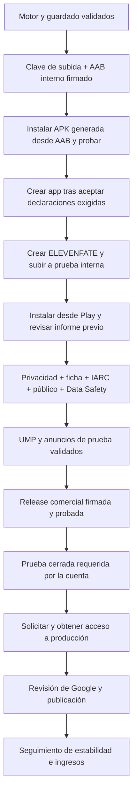

# ELEVENFATE — ruta de pruebas hasta Google Play

Actualizado: **2 de octubre de 2026**. Primera subida a **prueba interna completada**; siguiente fase: testers y activación. Objetivo final: publicación pública con anuncios validados. No confundir preparar el AAB, subirlo, distribuir una beta y publicar en producción.

## Estado real

- Motor y persistencia:736 casos distintos aprobados,3 carreras completas y carrera QA18→21; evidencia previa en `../PRUEBAS-DURAS-Y-PUBLICACION.md`.
- Nuevo **AAB interno firmado**, `com.elevenfate.game`, **versionCode 5**, `0.9.0-internal`, build `20261001.585a189306d1`. Mismos recursos del motor y vídeos que la v3; solo metadata web diferente.
- Firma de subida nueva RSA 3072, válida10.000 días; privada en `android/.local/signing/`, ignorada por Git. Certificado público entregado y huella registrada en Play comprobada.
- Bundletool valida el AAB y genera3APK divididas para el AVD; instaladas y probadas: elección real guardada,3 recuperaciones exactas con rotación y reinstalación de la misma versión. No se afirma una actualización comercial que todavía no existe. La repetición final incluye siete comprobaciones de superficie nativa y no registra ANR de sistema ni crash/ANR del juego en ese tramo.
- Esta primera variante **playtest no solicita anuncios**; tampoco expone diagnóstico y elimina permisos AD_ID/AdServices. La variante comercial `release` conserva el sistema de anuncios y sus controles anteriores. El AAB interno no debe promocionarse directamente a producción.
- **Estado actual de Console (2 de octubre):** El AAB v5 está subido, procesado y guardado como borrador de prueba interna. Google muestra 0 errores y 1 advertencia: no hay testers. El titular confirma que todavía no dispone de testers; no se ha añadido nadie ni activado la versión. Paquete com.elevenfate.game, versión 5 (0.9.0-internal), min24/target36, descarga indicada 55,5 MB. Play App Signing activo y certificado de subida coincidente. Política HTTPS guardada en Console. No equivale a aprobación de políticas ni producción.

## Esquema de trabajo



El texto de privacidad, los gráficos de ficha y los casos de anuncios pueden prepararse mientras se completan las verificaciones de cuenta. Las fases de cuenta, verificaciones y beta dependen de Google y del propietario; no tienen una fecha final garantizada.

## Fases, tareas y condiciones para avanzar

| Fase | Tareas concretas | Responsable | Condición de salida | Estado |
| --- | --- | --- | --- | --- |
| F0 — base funcional | Mantener identidad del motor; revisar informes de auditoría; guardar hashes y resultados; registrar cualquier cambio posterior. | Ingeniería | Sin fallos pendientes en los casos ejecutados; alcance anotado. | Completada dentro del alcance |
| F1 — paquete de subida | Crear upload key sin sobrescribir otra; configurar firma; generar offline; compilar R8/shrink; Lint/unit/offline; validar ZIP/manifiesto/certificado y generar splits. | Ingeniería | AAB real firmado, min24/target 36, appId comercial, sin secretos; runtime de ese hash aprobado. | Completada |
| F2 — acceso y subida interna | Cuenta habilitada; confirmar declaraciones y crear app gratuita/juego/español; configurar Play App Signing; crear borrador interno y subir AABv5. | Propietario + ingeniería | Subida procesada, paquete y versión correctos; registrar prueba de aceptación. | Completada: v5 procesada y borrador guardado |
| F3 — distribución interna | Añadir solo testers autorizados; abrir opt-in; instalar desde Play; recuperar partidas; revisar informe previo al lanzamiento y dispositivos. | Ingeniería + testers | Instalación con firma de Play comprobada y sin incidencias críticas abiertas. | Pendiente |
| F4 — privacidad y ficha | Definir responsable/contacto/dominio; publicar política HTTPS; revisar derechos de imágenes/clips/música; responder público/IARC/Data Safety; icono, gráfico y capturas; declarar anuncios y disponibilidad. | Propietario + ingeniería | Datos reales y textos sin placeholders; coherencia app/SDK/ficha; URL accesible en app y tienda. | Borradores preparados, faltan datos |
| F5 — anuncios | Configurar UMP para app real; usar dispositivos e IDs de prueba; aceptar/rechazar/reabrir; perfiles protegidos/adolescente/adulto; cierre/retorno/red; validar frecuencia y banner. | Ingeniería + propietario | Casos ADS/PRIVACY críticos aprobados con evidencia; ninguna impresión comercial de prueba. | Pendiente UMP/privacidad |
| F6 — release y beta cerrada | Generar nuevo release con privacyURL/revisión/IDs reales/firma; aumentar versionCode por encima del último subido; probar ese hash; beta y feedback reales;12 testers/14 días si la cuenta lo exige; dispositivos ARM. | Ingeniería + testers | Beta exigida y correcciones completas; solicitud de producción aprobada. | Pendiente |
| F7 — publicación y seguimiento | Completar revisión final de cambios; enviar release a Google; atender revisión; publicar; vigilar Android Vitals/ANR/reseñas/guardado y estado AdMob. | Propietario + ingeniería | App aprobada y disponible, monetización aprobada por AdMob por separado. | Pendiente |

**Antes de registrar la clave en Play:** guardar copia cifrada del keystore y conservar su contraseña en un gestor seguro fuera de este equipo. Esa copia no ha sido confirmada. No incluir `.local/signing` ni `release.properties` en Git, fichas, mensajes ni archivos públicos.

## Serie de pruebas: 67 casos trazables

La matriz `MATRIZ-DE-PRUEBAS.csv` contiene ID, pasos, resultado esperado, prioridad, variante y evidencia. Las últimas columnas permiten anotar dispositivo/API, fecha, hash y la incidencia. `test-plan.json` contiene la misma información para automatización.

Estados separados: **PASS v5** acredita el AAB actual; **PASS motor idéntico v3** reutiliza solo pruebas del mismo motor; **PASS QA/debug v3** corresponde a otra variante por hash; **PENDIENTE** es una prueba diseñada, no ejecutada. Nunca contar pendientes como aprobados. Los736 casos del motor y estas67 fichas no son una suma de casos ejecutados.

| Grupo | Qué comprueba | Ejecución |
| --- | --- | --- |
| BUNDLE | Firma, formato, identidad, recursos, permisos, splits, reinstalación y actualización futura. | Automatizada en parte; actualización Play pendiente. |
| GAME | Decisiones, resultados, dobles pulsaciones, ofertas, autosimulación, acciones y retiro. | Motor validado; recorrido completo en pantalla pendiente. |
| SAVE | Recuperación exacta, rotación,100 ciclos, SAF, proceso eliminado, corrupción y rollback. | Base aprobada; repetir proveedor remoto/release final. |
| ANDROID | Tamaños, Atrás, fondo, API24/29/33, móvil ARM, WebView y fuente ampliada. | API36 probada; otras versiones/físico pendientes. |
| MEDIA | Clips offline, reproducción completa/audio, interrupciones, accesibilidad y memoria. | Inicio30clips probado; audio/accesibilidad/carga prolongada pendientes. |
| ADS | Frecuencia, perfiles, intersticial/banner, fallos, cambio de edad e interrupción. | Política y protección probadas; impresiones de prueba pendientes. |
| PRIVACY | Política, UMP aceptar/rechazar/reabrir/fallo, edad, Data Safety y contenido/IARC. | Privacidad pública y flujo completo pendientes. |
| PLAY | Cuenta, upload, firma Google, instalación tienda, prelaunch, beta, producción y publicación. | App creada; v5 procesada y firma comprobada. Activación/testers/producción pendientes. |

## Incidencias del banco de pruebas y controles añadidos

La primera sonda de v4 falló por imports relativos ejecutados desde la instrumentación; se corrigió para usar el origen HTTPS local explícito. Al repetir la sonda se detectó que sus comandos de fixture reutilizaban identificadores ya persistidos: el motor los rechazó correctamente y la sonda ahora genera IDs únicos por ejecución. Son correcciones del arnés de pruebas; no se cambió el motor del juego.

System UI del AVD volvió a mostrar un diálogo de ANR. Las capturas afectadas se rechazaron. La sonda ahora verifica la superficie Android antes/después de los recorridos, borra el XML anterior antes de cada lectura y falla si hay un diálogo de error o la app no está visible. La sonda de captura rechaza una ventana activa ajena al juego; ese intento también se rechazó. Las cuatro capturas aceptadas se obtuvieron finalmente mediante screencap y navegación nativa, con ocho lecturas nuevas de UIAutomator que comprueban que solo está visible el paquete del juego y que no hay un diálogo de error. Las cuatro imágenes se revisaron visualmente. No se acredita una interfaz visible solo porque JavaScript responda detrás de un diálogo del sistema. Las evidencias actuales deben corresponder a la repetición posterior a recuperar ese entorno; los intentos anteriores quedan en `publication/attempts/`.

## Reglas de aceptación y gestión de incidencias

- **P0:** crash/ANR del juego, pérdida/corrupción de partida, doble efecto de decisión, anuncios/consentimiento incorrectos, firma/paquete/configuración inválidos. No avanzar de la fase afectada hasta reproducir, corregir y repetir la prueba sobre el nuevo hash.
- **P1:** controles inaccesibles, texto/corte que impide elegir, retorno de vídeo incorrecto, incompatibilidad o fallo persistente de navegación. Resolver antes de lanzamiento público; documentar limitaciones de una beta interna.
- Registrar por incidencia: ID de test, versión/hash, variante, dispositivo/API/WebView, pasos mínimos, esperado/obtenido, captura y logs filtrados. No adjuntar guardados personales ni credenciales a reportes públicos.
- Cambiar código o SDK exige repetir las pruebas afectadas y empaquetado/firmas. Cambiar IDs/UMP exige repetir la integración de anuncios. Cambiar lógica de sesión exige repetir persistencia, migraciones y carreras. No repetir pruebas caras sin cambio o preocupación que lo justifique.
- No usar tiempos del emulador con GPU por software como presupuesto de rendimiento de móvil. Para medir, fijar dispositivo y escena, registrar memoria/carga/arranque y comparar varias ejecuciones.

## Comandos reproducibles

Desde el repositorio `outputs/ELEVENFATE`, con JDK17 y el SDK configurados:

```sh
node scripts/prepare-android-upload-key.mjs
node scripts/build-android-offline.mjs
node scripts/build-android-apk.mjs --playtest --offline
node --test scripts/test-android-offline.mjs scripts/test-android-refinements.mjs
./android/gradlew -p android --offline -PtestVariant=playtest -PprobeRunner=com.multihistoria.AndroidPlayProbe assemblePlaytestAndroidTest
node scripts/test-android-play-bundle.mjs emulator-5562
python3 scripts/audit-android-play-bundle.py
node scripts/check-android-publication.mjs
node scripts/export-android-playtest.mjs
```

Configurar `JAVA_HOME`, `ANDROID_HOME`, `ANDROID_USER_HOME`, `GRADLE_USER_HOME` y `BUNDLETOOL` según `EJECUTAR-PRUEBAS.command`. El script de bundle exige el serial explícito y AVD `Elevenfate_QA_*`; no actúa en teléfonos. Arrancar el banco dedicado con `ARRANCAR-BANCO-DE-PRUEBAS.command` y mantener esa Terminal abierta; después ejecutar las pruebas en otra Terminal. El lanzador de juego anterior usa otro AVD/puerto y conserva la partida QA original. La preparación de firma es idempotente y rechaza otra clave/alias o un estado incompleto. `check-android-publication` devuelve código2 cuando hay pendientes; el control interno ya pasa; `--production` mantiene pendientes explícitos. `--production` añade la condición comercial, sin modificar ni completar declaraciones automáticamente.

## Guía de primera subida — pasos iniciales ya completados

1. La creación ya está habilitada y el formulario se ha preparado. El propietario debe confirmar las tres declaraciones: cumplimiento de políticas, Términos de Firma de Aplicaciones de Play y cumplimiento de leyes de exportación de EE. UU. La aceptación de términos requiere confirmación expresa antes de que el agente la ejecute. El paquete `com.elevenfate.game` está disponible; idioma es-ES, categoría Juego y Sin coste. La protección automática permanece en su estado predeterminado. No se ha pulsado «Crear aplicación». La guía de verificación de Android físico se conserva como referencia histórica de los requisitos de esta cuenta: [Google](https://support.google.com/googleplay/android-developer/answer/14316361?hl=es).
2. Con el panel disponible, **Crear aplicación**: ELEVENFATE, idioma español, tipo Juego y distribución gratuita como borrador propuesto. Revisar las declaraciones/condiciones que pida Google con los datos reales del propietario.
3. Seleccionar `com.elevenfate.game` como identificador del paquete preparado. La primera subida fija este nombre; ya está incluido en el AAB. No subir la QA `.qa` ni debug `.debug`.
4. Abrir **Probar y publicar → Pruebas → Prueba interna**, crear versión y configurar Play App Signing. Proponer clave de firma gestionada por Google y mantener esta clave local como upload key. Verificar el certificado de subida con el PEM entregado.
5. Subir **ELEVENFATE-0.9.0-internal-v5.aab**, hash `abe1946be828d86d0a48a9f2a37b3e13bbbdb790b309e432f0ed57139102e7aa`. Revisar procesamiento: versionCode 5, target 36, package y ningún error de firma. Registrar captura/estado e ID de versión. Completado el 2 de octubre: versión 5 procesada y borrador guardado, sin activar.
6. Nombre de versión propuesto: `0.9.0-internal-v5`. Pegar las notas de `NOTAS-DE-VERSION.txt`. Guardar borrador; revisar avisos. Después, distribuir a testers autorizados y verificar instalación desde Play. Este primer AAB mantiene las solicitudes de anuncios apagadas.
7. Si Play pide requisitos adicionales, anotarlos y completarlos; no dar por aceptado el AAB por pasar bundletool. El siguiente AAB comercial tendrá versionCode superior y pruebas del nuevo hash. No promocionar el interno sin anuncios a producción como si estuviese completa la monetización.

## Requisitos oficiales comprobados

El canal interno permite empezar con una app cuya configuración de ficha todavía está incompleta; la primera subida fija el paquete y los testers internos no cuentan automáticamente para la prueba cerrada. [Pruebas internas/cerradas](https://support.google.com/googleplay/android-developer/answer/9845334?hl=en).

Para cuentas personales creadas después del13noviembre2023: mínimo12inscritos durante14díascontinuos antes de solicitar acceso a producción; no equivale a una aprobación automática. [Requisito de prueba cerrada](https://support.google.com/googleplay/android-developer/answer/14151465?hl=en). Google puede requerir verificación mediante un Android físico sin root10+; no sirve el emulador. [Verificación de dispositivo](https://support.google.com/googleplay/android-developer/answer/14316361?hl=en).

API36 es el target requerido para nuevas apps desde31agosto2026; el paquete cumple ese requisito técnico. [Target API](https://support.google.com/googleplay/android-developer/answer/11926878?hl=en-gb). El AAB se firma con upload key y Google configura la firma de distribución en Play App Signing. [Firma](https://developer.android.com/studio/publish/app-signing).

AdMob25.5.0 puede transmitir IP/ubicación estimada, interacciones, diagnóstico e identificadores para anuncios, analítica y prevención de fraude; las solicitudesNPA no permiten declarar automáticamente «sin datos». La ficha comercial debe reflejar la app/SDK reales. [Datos del SDK](https://developers.google.com/admob/android/privacy/play-data-disclosure). La prueba de UMP necesita mensajes de la app configurados en AdMob. [UMP](https://developers.google.com/admob/android/privacy).

## Material preparado y lo que falta del propietario

Carpeta de entrega: `outputs/PLAY-CONSOLE/`. Contiene AAB/APK internos, certificado público, matriz y guías. Se entregan cuatro capturas reales del AAB interno v5 en `graficos/capturas-v5`, además de icono 512×512 y gráfico 1024×500 renderizados desde el símbolo E existente. `CAPTURAS.json` identifica el AAB y los hashes. Sustituir las capturas cuando cambie el aspecto de la versión comercial; su origen es una build interna sin anuncios.

El titular ha facilitado Pedro Sánchez Miguélez y pedrosamiguelez@gmail.com. Política publicada en https://capitanps02.github.io/Juego-Multihistoria/privacidad/ e incorporada/probada en AAB v5. Data Safety, revisión del SDK comercial y entrada de la URL en Console siguen pendientes. Quedan aceptar las declaraciones, crear la app y subir al canal interno; para publicación pública siguen pendientes público, privacidad, monetización y beta real.

## Evidencia de la primera subida completada

El AAB v5 está subido, procesado y guardado como borrador de prueba interna. Google muestra 0 errores y 1 advertencia: no hay testers. El titular confirma que todavía no dispone de testers; no se ha añadido nadie ni activado la versión. Paquete com.elevenfate.game, versión 5 (0.9.0-internal), min24/target36, descarga indicada 55,5 MB. Play App Signing activo y certificado de subida coincidente. Política HTTPS guardada en Console. No equivale a aprobación de políticas ni producción.

Consultar `play-console-upload-v5.json`; ID de app 4974149715286677550, ID de versión interna 1. No se ha verificado instalación desde tienda ni una actualización distribuida por Play. No se ha recuperado un hash del servidor: el hash corresponde al archivo local seleccionado para subir.
